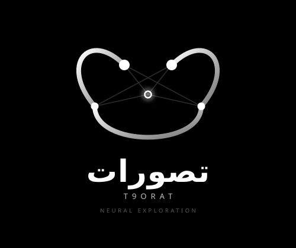

<div align="center">
  
  <h1>T9orat (تطوّرات)</h1>
  <p><strong>تطبيق ذكي لبناء الخرائط الذهنية وتوليد الأفكار باستخدام الذكاء الاصطناعي</strong></p>
  <a href="https://t9orat.lol">رابط النسخة المباشرة (Live Demo)</a>
</div>

<br />

## 🌟 عن المشروع (About The Project)

**T9orat (تطوّرات)** هو تطبيق ويب تفاعلي يهدف إلى مساعدة المستخدمين على تنظيم أفكارهم واستكشاف مواضيع جديدة باستخدام الذكاء الاصطناعي (Gemini / OpenAI / Groq). 
بمجرد إدخال فكرة أو موضوع، يقوم الذكاء الاصطناعي بتوليد خريطة ذهنية متكاملة تتضمن:
- الفكرة الأساسية
- أفكار فرعية وتفريعات
- توصيات للبحث والتوسع
- مصادر مقترحة للتعلم

## ✨ المميزات الرئيسية (Key Features)

- 🧠 **توليد خرائط ذهنية ذكية:** بناء شجرة أفكار لا نهائية بمجرد كتابة كلمة مفتاحية.
- 📝 **ملخص ذكي (AI Summary):** تحويل الخريطة الذهنية المعقدة إلى مقال سردي متماسك باللغة العربية بضغطة زر.
- ⭐ **تمييز الأفكار (Bookmarking):** إمكانية تمييز العقد المهمة بنجمة لتسهيل الوصول إليها وتذكرها.
- 📁 **إدارة الجلسات (Sessions):** حفظ الخرائط الذهنية محلياً والعودة إليها لاحقاً (دعم حفظ وإدارة عدة جلسات).
- 📱 **متجاوب بالكامل (Responsive):** تصميم حديث وزجاجي (Glassmorphism) يدعم جميع الشاشات والأجهزة المحمولة مع إيماءات لمس محسنة.
- 🔍 **لوحة جانبية تفصيلية (Side Panel):** استعراض تفاصيل أي عقدة، سياق الفكرة، وروابط بحث مباشرة (Google, YouTube, Wikipedia, Scholar).
- 🌙 **وضع ليلي/نهاري (Dark/Light Mode):** مريح للعين مع ألوان جذابة وحركات انتقالية سلسة.
- 💾 **تصدير البيانات:** إمكانية حفظ الخريطة الذهنية كصورة (PNG) أو تصديرها كملف نصي (Markdown).

## 🚀 التقنيات المستخدمة (Tech Stack)

- **React 18** + **Vite**
- **Tailwind CSS** (للتصميم المخصص والواجهة الزجاجية)
- **Framer Motion** (للحركات والانتقالات السلسة)
- **React Flow** (لرسم الخرائط الذهنية والعقد)
- **Google Generative AI SDK** (لدمج نماذج Gemini)
- **Lucide React** (للأيقونات)
- **Cloudflare Pages** (للنشر السريع والمجاني)

## 💻 التشغيل محلياً (Run Locally)

1. **تثبيت الحزم:**
   ```bash
   npm install
   ```
2. **تشغيل بيئة التطوير:**
   ```bash
   npm run dev
   ```
   سيعمل التطبيق على `http://localhost:3000/`. عند فتح التطبيق لأول مرة، سيُطلب منك إدخال مفتاح API الخاص بك (Gemini أو OpenAI) من خلال واجهة الإعدادات.

## 🤝 مساهمة
تم بناء هذا المشروع ليكون أداة مساعدة للعصف الذهني والبحث الذكي. نرحب بأي اقتراحات أو تحسينات (Pull Requests)!
